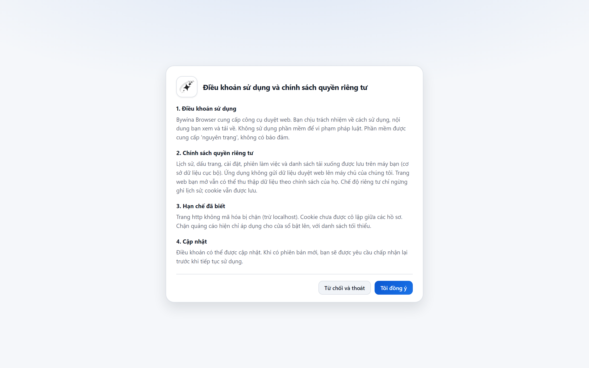

<p align="center">
  
</p>

<h1 align="center">Bytwina Browser</h1>

<p align="center">
  Trình duyệt desktop cho Windows x64 — Rust + Tauri 2 + WebView2.<br>
  Nhẹ, riêng tư, giao diện quen thuộc như Chrome/Cốc Cốc.
</p>

<p align="center">
  <a href="https://github.com/ninokiru/Bytwina-Browser/actions/workflows/ci.yml"></a>
  <a href="https://github.com/ninokiru/Bytwina-Browser/releases/latest"></a>
  <a href="LICENSE"></a>
</p>

> **Bản thử nghiệm (0.0.5).** Đủ tính năng để dùng hằng ngày, nhưng chưa được kiểm thử tay đầy đủ trên mọi cấu hình Windows và chưa ký số — SmartScreen sẽ cảnh báo khi cài.

## Tải và cài

1. Vào [bản phát hành mới nhất](https://github.com/ninokiru/Bytwina-Browser/releases/latest), tải `Bytwina.Browser_x.y.z_x64-setup.exe`.
2. Đối chiếu SHA256 với `SHA256SUMS.txt` (`Get-FileHash .\Bytwina.Browser_*_setup.exe`).
3. Cài, mở app. Cần **WebView2 Runtime** (có sẵn trên Windows 10/11 mới cập nhật).

## Hình ảnh

| Trang tab mới | Đang duyệt |
|---|---|
|  |  |

| Menu ⋮ | Cài đặt |
|---|---|
|  |  |

| Tab dọc | Giao diện tối |
|---|---|
|  |  |

| Kho mật khẩu | |
|---|---|
|  | |

Ảnh do workflow `screenshots.yml` chụp tự động từ `preview.html` bằng đúng React/CSS của ứng dụng (xem [scripts/capture-screens.mjs](scripts/capture-screens.mjs)) — không phải mockup.

## Chức năng

**Duyệt web**
- Đa tab với WebView2 thật (mỗi tab một webview, tab ngủ khi rảnh để tiết kiệm RAM).
- Tab dọc/ngang, ghim tab, nhóm tab, chia màn hình (split view), tìm tab.
- Thanh địa chỉ: nhận tên miền, `localhost:3000`, `host:port`; từ khóa còn lại đi qua công cụ tìm kiếm đã chọn (DuckDuckGo/Google).
- Trang nội bộ `bytwina://settings`, `bytwina://history`… bắt ngay trong ô địa chỉ.
- Popup `target=_blank` thành tab nền (tối đa 16 tab/lượt), chặn mở cửa sổ lạ.

**Riêng tư và bảo mật**
- Chế độ riêng tư dùng InPrivate thật của WebView2; không ghi lịch sử, không ghi phiên.
- Chặn quảng cáo và tracker ở tầng request (adblock-rust) với EasyList, EasyPrivacy, uBlock filters, ABPvn; tắt theo từng trang bằng nút khiên.
- Ẩn phần tử quảng cáo bằng CSS (lọc thẩm mỹ) sau khi trang tải xong.
- Quyền trang web (camera, micro, thông báo, vị trí, clipboard, âm thanh tự phát) hỏi từng lần, lưu quyết định theo origin.
- Kho mật khẩu mã hóa từng mục bằng AES-256-GCM; khóa suy ra với Argon2id (64 MiB, 3 vòng, 4 lanes), chỉ giữ trong RAM và tự khóa theo thời gian hoặc sau 30 giây mất focus.
- Chặn trang `http://` không mã hóa (trừ localhost) — xem [ADR-011](docs/DECISIONS.md).
- IPC chỉ nhận từ webview toolbar; trang web không gọi được lệnh của ứng dụng.

**Dữ liệu**
- SQLite tại chỗ: lịch sử, dấu trang, danh sách đọc, tải xuống, cài đặt, phiên.
- Khôi phục phiên sau khi thoát (chế độ "mở lại trang đã dùng").
- Sao lưu/khôi phục CSDL (`VACUUM INTO`, áp dụng ở lần khởi động sau); xóa dữ liệu theo khoảng thời gian.
- Tải xuống có tiến trình, mở thư mục chứa file.

**Giao diện**
- Sáng/tối/theo hệ thống, chọn ngôn ngữ Việt/Anh.
- Cài đặt kiểu master–detail như Cốc Cốc, có ô tìm kiếm trong trang cài đặt.
- Menu ⋮ có cột phím tắt, hàng thu phóng, hồ sơ khách.
- Khởi động cùng Windows, mở "Ứng dụng mặc định" của Windows, đặt lại cài đặt.
- Tự cập nhật từ GitHub Releases (có chữ ký) — bật bằng menu ⋮ → "Cập nhật Bytwina".

**Phím tắt** (khi tiêu điểm ở thanh công cụ)

| Phím | Việc |
|---|---|
| Ctrl+T / Ctrl+L / Ctrl+R | Tab mới / chọn ô địa chỉ / tải lại |
| Ctrl+Shift+N | Bật/tắt chế độ riêng tư |
| Ctrl+H / Ctrl+J / Ctrl+Shift+O | Lịch sử / tải xuống / dấu trang |
| Ctrl+D | Đánh dấu trang này |
| Ctrl+Shift+Delete | Mở phần xóa dữ liệu |
| Ctrl+Tab | Tab tiếp theo (Shift: lùi) |
| Alt+← / Alt+→ | Lùi / tiến |
| Ctrl+Q | Thoát |

## Kỹ thuật và thư viện

Kiến trúc: vỏ ứng dụng **Rust + Tauri 2**, mỗi tab là một **WebView2** native gắn làm webview con của cửa sổ chính (không dùng iframe). Thanh công cụ là webview riêng, và là webview duy nhất được phép gọi lệnh IPC; webview của trang web không gọi được lệnh nào của ứng dụng. Giao diện thanh công cụ, cài đặt và các trang nội bộ viết bằng React + TypeScript, build bằng Vite.

| Thành phần | Thư viện / công nghệ | Dùng để làm gì |
|---|---|---|
| Cửa sổ, nhiều webview, IPC | Tauri 2 (`tauri`, `unstable` cho `add_child`) | Quản lý cửa sổ và các tab |
| Engine trình duyệt | WebView2 qua `wry`, `webview2-com`, `windows` | Hiển thị trang, InPrivate, tải xuống, quyền trang, lọc mạng |
| Lưu trữ cục bộ | `rusqlite` (SQLite bundled, WAL) | Lịch sử, dấu trang, phiên, cài đặt và dữ liệu app; chỉ payload bí mật trong kho mật khẩu được mã hóa |
| Chặn quảng cáo / tracker | `adblock` (adblock-rust) | Khớp luật AdBlock Plus ở tầng request và lọc thẩm mỹ |
| Tải danh sách lọc | `ureq` 3 (rustls) | Tải danh sách lúc chạy, không nhúng vào repo |
| Tên miền gốc | `psl` | Phân biệt bên thứ nhất / thứ ba cho luật chặn |
| Mã hóa kho mật khẩu | `argon2`, `aes-gcm`, `zeroize` | Suy khóa từ mật khẩu chủ, mã hóa AES-256-GCM, xóa khóa khỏi RAM |
| Tự cập nhật | `tauri-plugin-updater` | Đọc `latest.json`, kiểm chữ ký minisign |
| Khởi động cùng Windows | `tauri-plugin-autostart` | Đăng ký chạy khi đăng nhập |
| Giao diện | React 18, TypeScript, Vite 6 | Thanh công cụ, cài đặt, bảng nổi |

Danh sách đầy đủ và lý do từng thư viện: [docs/DEPENDENCIES.md](docs/DEPENDENCIES.md).

## Bảo mật (tóm tắt)

Chi tiết và những gì **chưa** làm: [docs/SECURITY.md](docs/SECURITY.md). Điểm chính:

- **Ranh giới tin cậy**: chỉ webview thanh công cụ gọi được IPC; kiểm tra nhãn webview ở phía Rust, không chỉ dựa vào ACL.
- **Điều hướng**: chặn trang `http://` không mã hóa (trừ localhost); popup thành tab nền thay vì mở cửa sổ mới.
- **Quyền trang** (camera, micro, vị trí, thông báo…): hỏi từng lần, có thể nhớ theo origin; origin được kiểm tra định dạng trước khi lưu.
- **Kho mật khẩu**: Argon2id (64 MiB, 3 vòng, 4 lanes) + AES-256-GCM từng mục; mật khẩu chủ không được lưu; khóa chỉ nằm trong RAM. Sai 5 lần mở khóa sẽ bị chờ 30 giây. Tệp SQLite tổng thể chưa mã hóa; lịch sử, bookmark, metadata vault và các bảng khác vẫn có thể đọc được nếu lấy được file DB. Recovery Kit chưa được triển khai.
- **Riêng tư**: chế độ riêng tư không ghi lịch sử và không ghi phiên; tab mới dùng InPrivate của WebView2.
- **Tải xuống**: file thực thi hoặc script (`.exe`, `.ps1`, `.msi`…) được đổi đuôi thành `.download` để không chạy trực tiếp.
- **Khóa khi rời cửa sổ**: Vault tự khóa sau 30 giây cửa sổ mất focus; cookie/cache WebView2 không bị xóa bởi hành động này.
- **Nhật ký**: không ghi URL hay nội dung trang; tự xoay vòng.
- **Tự cập nhật**: chỉ cài bản có chữ ký hợp lệ khớp khóa công khai; bản build đã ký từ chối mọi tệp không khớp khóa.
- **Chưa có**: chữ ký số (SmartScreen cảnh báo khi cài), cô lập cookie bên thứ ba ở mức API WebView2, kiểm toán bảo mật độc lập.

Dữ liệu lưu ở đâu và app kết nối tới đâu: [docs/PRIVACY.md](docs/PRIVACY.md).

## Chưa có (nói thẳng)

- Reader Mode và in/xuất PDF: chưa làm.
- Tự động điền mật khẩu từ kho: mới có kho, chưa bắt form đăng nhập.
- Nhiều hồ sơ người dùng tách biệt: chưa.
- Luật chặn phần tử **chung** (`.advert` không kèm tên miền) hiện chưa khớp; luật theo tên miền (`site##.advert`) vẫn chạy. Xem [docs/ROADMAP.md](docs/ROADMAP.md).
- Chưa ký số code signing; chưa có bản Linux/macOS.

## Build từ mã nguồn

Cần: Rust stable (MSVC), Node.js 22, WebView2 Runtime.

```powershell
cd apps/desktop
npm ci
npx tauri build --bundles nsis
```

CI trên GitHub Actions (`windows-2025`) chạy: `cargo fmt --check`, `cargo clippy -D warnings`, `cargo check/test --all-targets`, type check + build frontend. Bộ cài sinh ra khi đẩy tag `v*.*.*` (workflow `release.yml`).

## Tài liệu

| Tệp | Nội dung |
|---|---|
| [docs/USER_GUIDE.md](docs/USER_GUIDE.md) | Hướng dẫn sử dụng |
| [docs/ARCHITECTURE.md](docs/ARCHITECTURE.md) | Kiến trúc, luồng dữ liệu, ranh giới tin cậy |
| [docs/DECISIONS.md](docs/DECISIONS.md) | Nhật ký quyết định (ADR-001 … ADR-015) |
| [docs/SECURITY.md](docs/SECURITY.md) | Mô hình bảo mật và những gì đã biết là thiếu |
| [docs/TESTING.md](docs/TESTING.md) | Cách kiểm thử, những gì CI chứng minh được và không |
| [docs/PERFORMANCE.md](docs/PERFORMANCE.md) | Số đo hiệu năng, cách chạy lại |
| [docs/RELEASE.md](docs/RELEASE.md) | Quy trình phát hành và khoá ký tự cập nhật |
| [docs/ROADMAP.md](docs/ROADMAP.md) | Việc còn lại |
| [docs/CHANGELOG.md](docs/CHANGELOG.md) | Thay đổi theo phiên bản |
| [docs/SUPPORT.md](docs/SUPPORT.md) | Báo lỗi, môi trường được hỗ trợ |
| [docs/PRIVACY.md](docs/PRIVACY.md) | Dữ liệu lưu ở đâu, app kết nối tới đâu, cách xóa |
| [docs/DEPENDENCIES.md](docs/DEPENDENCIES.md) | Thư viện Rust và JavaScript, mục đích từng thư viện |
| [CONTRIBUTING.md](CONTRIBUTING.md) | Quy ước mã và quy trình gửi thay đổi |
| [CODE_OF_CONDUCT.md](CODE_OF_CONDUCT.md) | Quy tắc ứng xử |

## Giấy phép

- **Mã nguồn** của Bytwina Browser theo [giấy phép MIT](LICENSE).
- **Thư viện bên thứ ba** giữ giấy phép của chúng; ghi chú tại [third_party/LICENSES.md](third_party/LICENSES.md).
- **Danh sách lọc quảng cáo** không nằm trong repo: ứng dụng tải lúc chạy từ EasyList, uBlock Origin và ABPvn. Mỗi nguồn có giấy phép riêng (có nguồn ghi GPL-3, có nguồn có giấy phép kép với CC BY-SA); cần đối chiếu trước khi phân phối lại.
- **WebView2 Runtime** do Microsoft cung cấp, theo điều khoản của Microsoft; không được đóng gói cùng bộ cài.
- Bảng giấy phép của toàn bộ cây phụ thuộc **chưa được sinh tự động**; cần thêm trước bản công khai.
